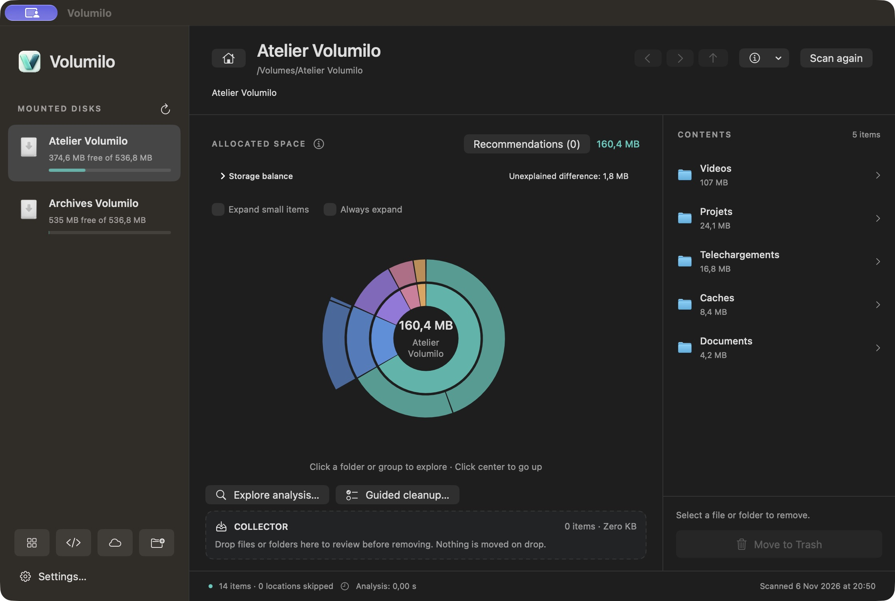
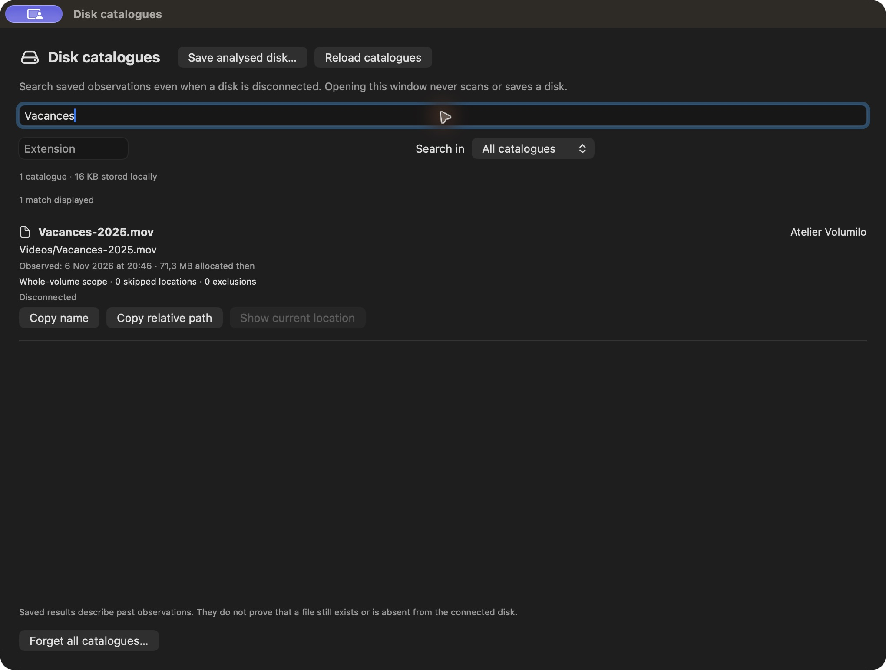
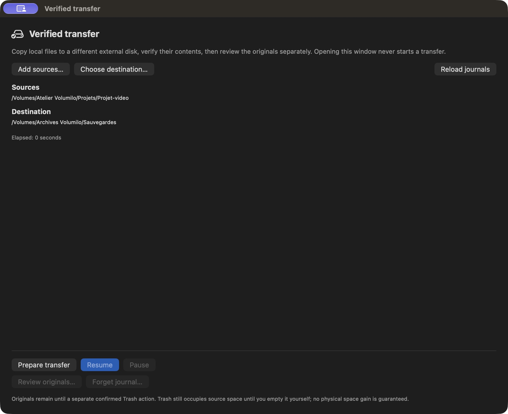
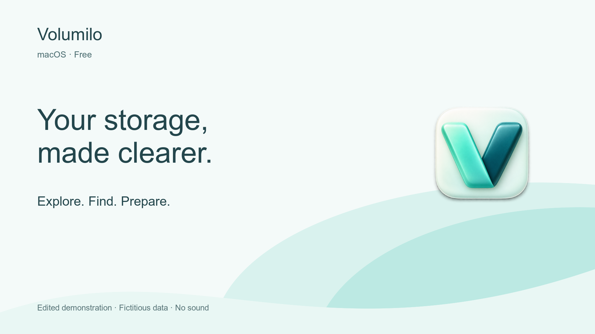

# Volumilo

**See what takes up space. Choose what to clean up or move.**

A native macOS app for exploring storage, finding files in a disconnected disk’s saved catalogue and preparing verified copies to an external disk.

**Free · Apple Silicon · macOS 14+ · French and English**

**[Download Volumilo](https://github.com/Raxuis/volumilo-releases/releases/latest)** · [Get started](QUICKSTART.en.md) · [Français](README.md)

Development release, locally signed and not notarized by Apple: macOS may block opening it. [Installation and verification](QUICKSTART.en.md#install-volumilo).

## Three useful starting points

### Understand a disk that is filling up

Scan a disk or folder you choose. Explore its circular chart and file list, open folders and collect items for review before removal. Dragging an item into the collector selects it; it does not delete it.

### Find a file without reconnecting every disk

After scanning a whole external disk, explicitly save its catalogue. Search names, paths and extensions while disconnected or after restarting the app. Results retain observation dates and coverage: they describe the past, not a guarantee that a file still exists.

### Prepare a transfer before changing the originals

Choose files and a destination folder on a different external volume. Volumilo copies, then rereads contents to verify them. Moving originals to Trash is a separate decision with fresh checks. Resuming an interrupted transfer is always manual.

## Watch the three uses in 40 seconds

**[Play the English video](media/volumilo-demo-en.mp4)** · [Vidéo française](media/volumilo-demo-fr.mp4)

An edited demonstration using real interface captures, with files and volumes created for the example. No sound. The transfer scene shows preparation, not a completed copy. No personal files are shown.

## Also included

- **Application storage**: analyse one app and review associated caches.
- **Guided cleanup and duplicates**: understand suggestions and choose items for review.
- **Developer workspace**: identify supported generated folders and how they can be rebuilt.
- **What grew?** and **folder monitoring**: compare observations and watch selected folders.
- **Menu bar summary**: check free space without running a scan.

## Stay in control

Ordinary scans remain in memory during the session. Catalogues you explicitly save and transfer journals stay on this Mac; they retain paths and metadata, not file contents. They can still reveal private information.

Recommendations do not prove that a file is unnecessary. Protected or unreadable locations are reported. Cloud support covers synced Finder folders; some checks refuse files that are not local. Trash is not emptied automatically. [Limits and practical answers](QUICKSTART.en.md#good-to-know).

This repository contains public downloads, guides and media. **Source code remains private.** The app being free does not grant a license to reuse its code or media.
