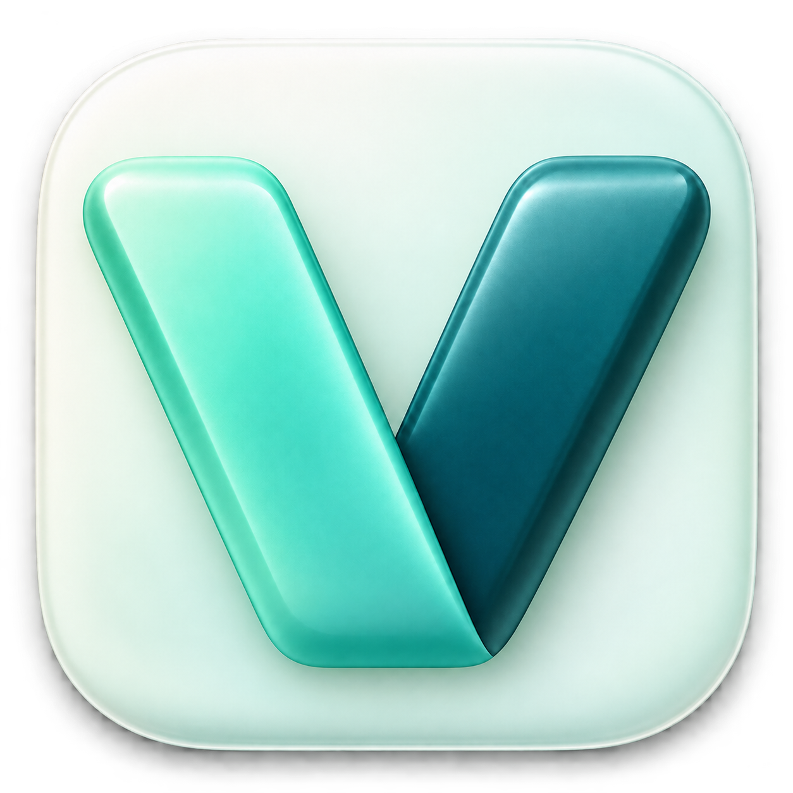
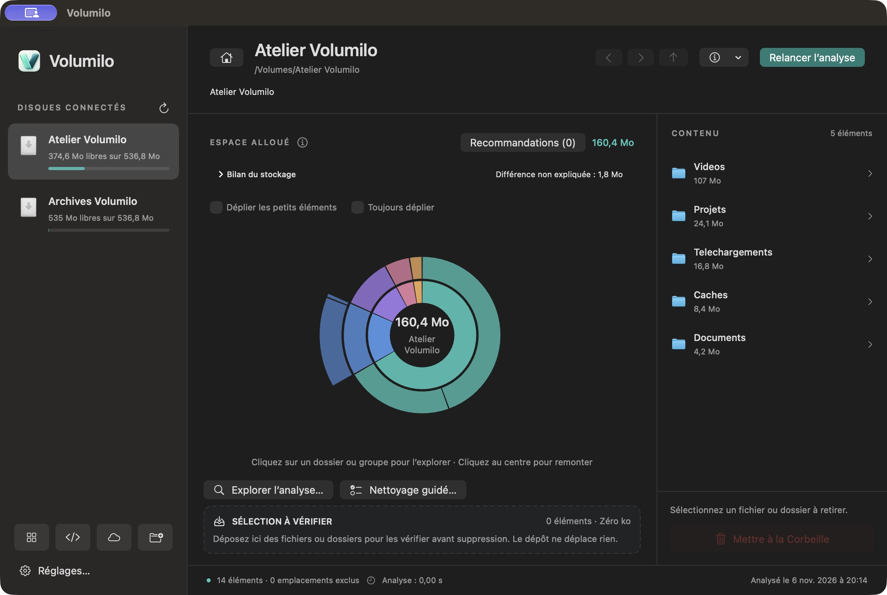
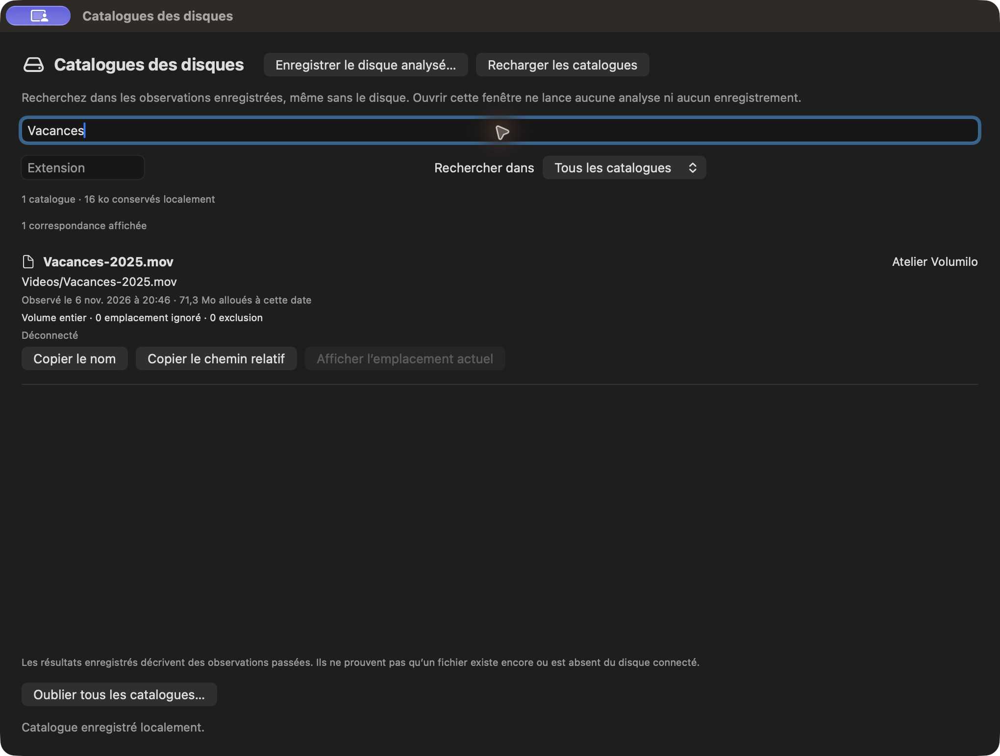
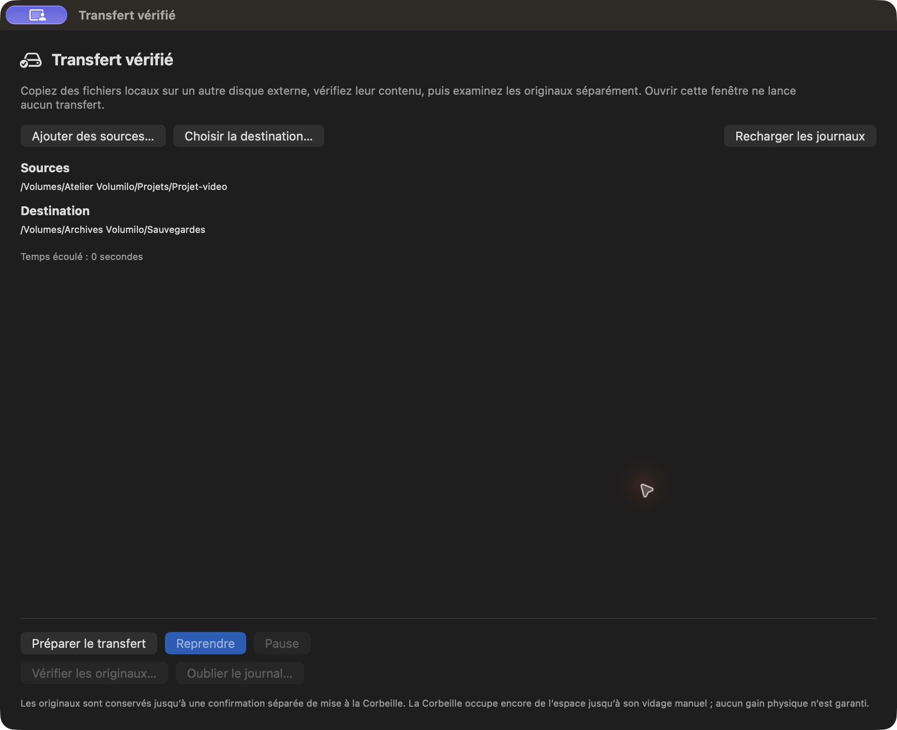
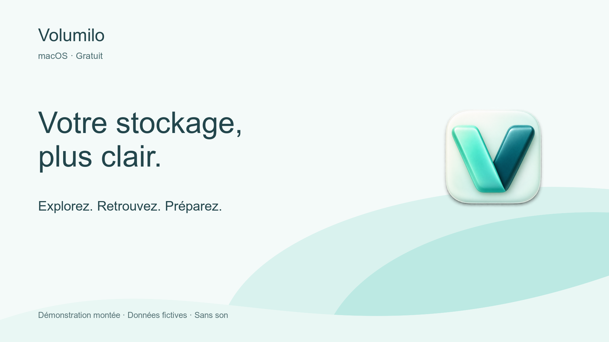

# Volumilo

**Comprenez ce qui prend de la place. Choisissez quoi nettoyer ou déplacer.**

Une app macOS native pour explorer votre stockage, retrouver un fichier dans le catalogue d’un disque débranché et préparer une copie vérifiée vers un disque externe.

**Gratuit · Apple Silicon · macOS 14+ · Français et anglais**

**[Télécharger Volumilo](https://github.com/Raxuis/volumilo-releases/releases/latest)** · [Bien démarrer](QUICKSTART.fr.md) · [English](README.en.md)

[Essayer la bêta](BETA.fr.md) · [Envoyer un retour](SUPPORT.md) · [Kit de présentation](PRESSKIT.fr.md)

Version en développement, signée localement et non notariée par Apple : macOS peut en bloquer l’ouverture. [Installation et vérification](QUICKSTART.fr.md#installer-volumilo).

## Trois façons de vous aider

### Comprendre un disque qui se remplit

Analysez le disque ou le dossier de votre choix. Explorez le graphique circulaire et la liste des fichiers, ouvrez les dossiers et préparez une sélection à examiner avant suppression. Le glisser-déposer ajoute à la sélection ; il ne supprime rien.

### Retrouver un fichier sans rebrancher tous vos disques

Après l’analyse d’un disque externe entier, enregistrez volontairement son catalogue. Recherchez ensuite noms, chemins et extensions, même après déconnexion ou relance. Les résultats conservent leur date et leur couverture : ce sont des observations passées, pas une garantie que le fichier existe encore.

### Préparer un transfert avant de toucher aux originaux

Choisissez les fichiers et un dossier sur un autre volume externe. Volumilo copie puis relit le contenu pour le vérifier. La mise à la Corbeille des originaux reste une décision séparée, avec de nouveaux contrôles. La reprise après interruption est volontaire.

## Voir les trois usages en 20 secondes

**[Lire la vidéo française](media/volumilo-demo-fr.mp4)** · [English video](media/volumilo-demo-en.mp4)

Démonstration montée à partir de captures de la vraie interface, avec des fichiers et volumes créés pour l’exemple. Sans son. La scène de transfert montre sa préparation, pas une copie achevée. Aucun fichier personnel n’est montré.

## Aussi disponible

- **Stockage par application** : analyser une app et examiner ses caches associés.
- **Nettoyage guidé et doublons** : comprendre les suggestions et choisir les éléments à examiner.
- **Vue développeur** : repérer les dossiers générés reconnus et leurs conditions de reconstruction.
- **Qu’est-ce qui a grossi ?** et **surveillance de dossiers** : comparer des observations et suivre les dossiers choisis.
- **Barre de menus** : consulter l’espace libre sans lancer d’analyse.

## Garder le contrôle

Les analyses ordinaires restent en mémoire pendant la session. Les catalogues que vous choisissez d’enregistrer et les journaux de transfert restent sur ce Mac ; ils contiennent des chemins et métadonnées, pas le contenu des fichiers. Ils peuvent néanmoins révéler des informations privées.

Les recommandations ne prouvent pas qu’un fichier est inutile. Les emplacements protégés ou illisibles sont signalés. Le cloud concerne les dossiers synchronisés du Finder ; certains contrôles refusent les fichiers non locaux. La Corbeille n’est pas vidée automatiquement. [Limites et réponses pratiques](QUICKSTART.fr.md#à-savoir).

Ce dépôt contient les téléchargements, les guides et les médias publics. **Le code source reste privé.** La gratuité de l’app ne constitue pas une licence de réutilisation du code ou des médias.
